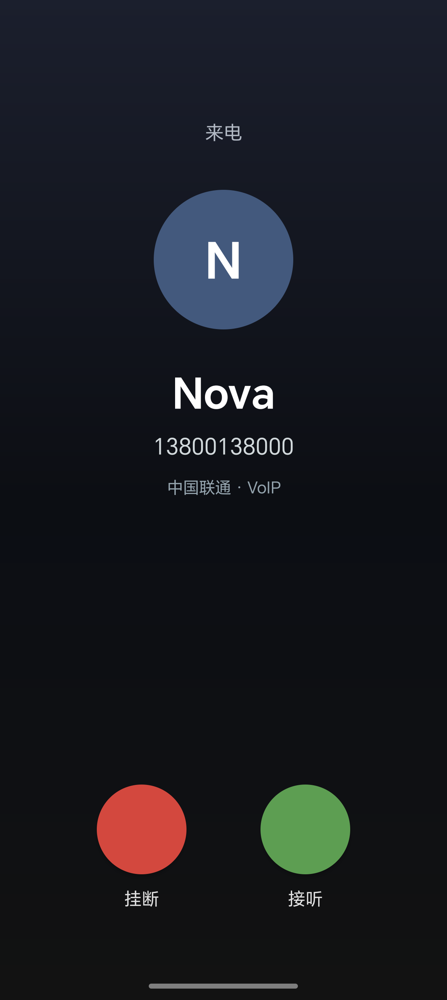

<div align="center">

# 鲸鱼 Whale · 手机端

**让你的私人 AI 住进手机：随时聊天、及时提醒、记住你的日常，也能替你操作手机。**

*身无彩凤双飞翼，心有灵犀一点通*

[下载 APK](https://github.com/amwangfan/whale-mobile/releases/latest) · [三步连接](#三步连接) · [能做什么](#它能做什么) · [隐私](#隐私) · [电脑端 whale-core](https://github.com/amwangfan/whale-core)

</div>

## 这是什么

**whale-mobile 是鲸鱼的 Android 手机端**，它需要配合电脑上的 [whale-core](https://github.com/amwangfan/whale-core)（鲸鱼的「大脑」）一起使用：

- **它是前端（客户端）**：在手机上和鲸鱼聊天、处理它发来的审批和通知、查看日程，界面和电脑控制台用的是同一套对话、记忆和任务。
- **它也是鲸鱼的「身体」**：在你授权的范围内，鲸鱼可以通过手机看到你的日常、给你推送提醒、在专用手机上自己点按和操作应用。
- 手机只负责**感知、展示和执行**；思考、记忆和决定都在你自己的电脑上完成。手机与电脑之间用设备密钥加密认证，聊天记录和记忆不会上传到任何第三方服务器。

## 下载

到 **[Releases](https://github.com/amwangfan/whale-mobile/releases/latest)** 下载最新 APK，在手机上打开安装（如提示「未知来源」，按提示允许本次安装）：

| 安装包 | 适合 |
| --- | --- |
| `whale-…-daily.apk` | **你平时用的手机**（绝大多数人选这个，无需 Root） |
| `whale-…-root.apk` | 专门给鲸鱼使用的 Root 手机：拥有 Shell、文件、录屏等全部能力 |

需要 Android 8.0 或更新版本。

## 三步连接

1. 在电脑上打开鲸鱼控制台，进入 **设备 → 配对新设备**（第一次使用时设置引导里也有这一步）。如果提示「只允许本机访问」，先打开「**允许局域网里的手机连接**」并重启。
2. 控制台会显示**手机连接地址**（如 `http://192.168.1.10:8080`）和一个 **6 位配对码**。
3. 在手机 App 里打开 **我的 → Core 连接设置**，填入地址，输入配对码，点「**配对并连接**」。

连接成功后，电脑控制台的「设备」页里就会出现这台手机，你可以在那里给它起名字、选择它是「**日常手机**」还是「**鲸鱼专用手机**」、设置要排除记录的应用。

> 手机和电脑需要在同一个 Wi-Fi 下；不在家时，可以用 Tailscale 等组网工具把两者连到一起，再填组网地址即可。

## 它能做什么

App 底部有五个页面：

| 页面 | 你可以 |
| --- | --- |
| **聊天** | 和鲸鱼对话（文字、图片、表情），回复实时流出；展开每条回复的「思维轨迹」，看它想起了哪些记忆、用了什么能力；需要你同意的操作直接在对话里批准或拒绝 |
| **感知** | 浏览手机记录下来的屏幕时间线，搜索「我前天在哪个 App 看到过这个」，收藏重要的瞬间，管理占用空间 |
| **通知** | 鲸鱼发给你的提醒、任务完成通知、待你处理的审批，都汇总在这里 |
| **日程** | 鲸鱼从对话、眼镜和手机里整理出的日程，每一条都能追溯来源，确认或修改 |
| **我的** | 连接设置、各功能模块的开关与权限 |

此外还有：

- **来电式提醒**：重要的事情，鲸鱼可以像打电话一样「呼叫」你，接听后直接语音对话（需要在电脑端配置语音桥，见 [server/audio-bridge](server/audio-bridge/)）。

  

- **智能眼镜**：连接雷鸟眼镜后，提醒和简短回复可以显示在镜片上，敏感内容不会上镜；没连眼镜时自动改为手机通知。
- **替你操作手机**（需要你开启 Whale 无障碍服务，或使用 Root 版）：打开应用、点按、滑动、输入文字、返回主页——鲸鱼可以帮你完成「打开 B 站搜一个视频播放」这类事情。每个动作都有明确的结果回执，紧急情况下可以随时一键停止。

在电脑控制台的「设备」页，可以实时看到手机的在线状态、电量、正在使用的应用，并直接下发动作：


## 隐私

手机分两种角色，你可以在电脑控制台随时切换：

- **日常手机**（默认，daily 版）：鲸鱼会记住你在手机上的经历，但以下内容**永远不会保存**——锁屏、密码输入框、安全窗口、通知栏与系统界面、输入法、系统设置、安全中心、密码管理器和验证器。你还可以添加**不想被记录的应用和网站**；验证码、银行卡号、身份证号在保存前会自动打码。
- **鲸鱼专用手机**（root 版默认）：这是给鲸鱼自己用的手机，它拥有全部能力，经历原样记录。

其他保护：

- 每台手机都有自己的设备密钥（存放在系统安全区），配对码只能用一次、10 分钟内有效；在电脑上**撤销**设备会立即断开。
- 每一项手机能力（点按、执行命令、读取屏幕……）都可以单独授权；鲸鱼只能做你允许的事。
- 所有模块都可以在「我的」里单独关闭，或一键全部暂停。

## 常见问题

**连不上 Core？** 检查：① 地址里的 IP 和端口与电脑控制台显示的一致；② 电脑上已打开「允许局域网里的手机连接」并重启过；③ Windows 防火墙已允许鲸鱼；④ 手机和电脑在同一个 Wi-Fi。

**配对码提示无效？** 配对码只能用一次且 10 分钟内有效，在电脑上重新生成即可。

**后台被杀、收不到提醒？** 在系统设置里把 Whale 的电池策略设为「不限制」，并允许自启动（各品牌位置不同，可参考 [Magic8 Pro 设置指南](docs/SETUP-MAGIC8.md)）。

**日常手机想让鲸鱼帮忙操作？** 在系统「无障碍」设置中开启「Whale 屏幕感知与操控」，无需 Root。

## 给开发者

Flutter（界面）+ Kotlin（常驻服务、设备传输、感知与执行）。与电脑端之间的设备协议在 [`contracts/device/`](contracts/device/)（镜像自 whale-core）。

```bash
git clone https://github.com/amwangfan/whale-mobile.git && cd whale-mobile
pip install -r requirements-test.txt && python3 tests/contract_validate.py
cd app && flutter pub get && flutter test
flutter build apk --release --flavor daily      # 或 --flavor root
```

推送 `v*` 标签会通过 [release 工作流](.github/workflows/release.yml) 自动构建两个 APK 并发布到 Releases。更多见 [架构](docs/ARCHITECTURE.md)、[AI 开发指南](docs/AI_DEVELOPMENT_GUIDE.md)、[当前进度](docs/STATUS.md)。

## 许可与致谢

屏幕采集与检索参考 [ScreenMemo](https://github.com/woijfwefw/ScreenMemo)（AGPL-3.0）；部分 VoIP 与前台监测代码源自 whale-io。引入第三方代码或素材时按其实际许可证处理。
