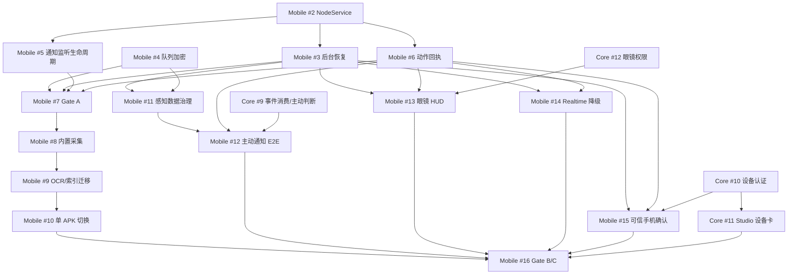

# Whale Mobile × Whale Core：P0–P2 执行目标链

> 版本：2026-11-01 / 基线 `whale-mobile@eab9dcd`、`whale-core@9e413c4`。这是**执行计划**而非已实现声明。
> Issue 总控：[whale-mobile #1](https://github.com/amwangfan/whale-mobile/issues/1)。具体子任务以 Issue 验收标准为准。本文件不代替既有 `ROADMAP.md` / `docs/GATE-A.md`，而是审查后续工作的增量排序。
> 与实际硬件有关的结果必须以真实设备、日期、软件版本、日志/回执和复测方式注明；模拟通过不等于设备通过。

## 0. 分工和不得退让的不变量

- **whale-mobile** 负责 Android 宿主、设备认证客户端、感知与本地隐私过滤、通知/VoIP/眼镜执行、系统回执与离线缓存；不复制 Core 的人格、意图或记忆权限。
- **whale-core** 负责账号/会话权限、感知事件消费与主动判断、任务调度、权限审核、Studio、可信授权的签发与审计；禁止 Core 直接调用 Android API。
- **端云契约** 以 `contracts/v1` 为事实来源。协议变更先写 Schema/黄金样例与兼容策略，再并行更改两端，禁止两仓互相 import 内部代码。
- 屏幕/通知属于 owner_private/owner_sensitive；群聊不能读取原始私人内容，未经授权不得将 ScreenMemo 原始库直接连入会话；Fork 需独立物理复制与审核。
- **动作回执不能造假**：received/accepted/executed/failed/unknown 严格区分，第三方桥若不提供真实确认只能报未知/受理。
- 禁任意远程 Shell、任意 Intent、任意图片路径；机端和 Core 都执行授权检查。暂停与设备撤销优先于所有运行任务。
- 对 Android 后台服务、开机启动、通知、屏幕录制、麦克风使用官方规则；**不承诺“任何系统上永远在线”**。可用时优先采用明确且可取消的用户授权机制。

## 1. 目标 DAG（不是单线瀑布）

> **可并行**：#4 与 #2；#5/#6 在 NodeService API 冻结后分别实现；#11 与 #8–#10 并行；眼镜/语音/授权 UI 分支可以并行，但各自合并前必须满足契约和实机准入。以上 DAG 表示关键集成/验收依赖，具体 Issue 内的纯测试或预研可以提前进行。

## 2. Gate A · 后台与安全可信基线（P0 优先）

| 顺序 | Issue | 拟定 PR | 核心交付 / 不接受的伪完成 |
|---|---|---|---|
| A1 | [#2 NodeService](https://github.com/amwangfan/whale-mobile/issues/2) | `p0/bg01-node-service` | 将 WSS / 队列 / 设备身份 / 执行器生命周期从 Flutter Activity 移到 Android Service；Flutter 页面销毁后不重建或失联 |
| A2 | [#3 后台恢复](https://github.com/amwangfan/whale-mobile/issues/3) | `p0/bg02-background-recovery` | 锁屏、Doze、重启、网络切换、后台回收的明确恢复/降级策略；合规 FGS + 可延迟 WorkManager |
| A3 | [#4 队列加密](https://github.com/amwangfan/whale-mobile/issues/4) | `p1/sec01-encrypted-queue` | 保护敏感 payload 的 Keystore AES-GCM 或 SQLCipher，明文升级迁移与故障恢复 |
| A4 | [#5 通知监听独立性](https://github.com/amwangfan/whale-mobile/issues/5) | `p1/sec02-listener-lifecycle` | UI 不启动也能处理/丢弃监听事件；无正文和未授权外泄 |
| A5 | [#6 回执与幂等](https://github.com/amwangfan/whale-mobile/issues/6) | `p1/sec03-action-receipts` | 没有执行器不允许悬挂 accepted；动作跨重启不可无条件重放；真实失败不可报 executed |
| A6 | [#7 Gate A 实机](https://github.com/amwangfan/whale-mobile/issues/7) | `p0/ga01-device-acceptance` | 24h 耗电、Magic8 Pro、Leaf5/nova、锁屏/强杀/重启矩阵。没有硬件复测，Gate 保持 blocked |

Gate A 合并标准：所有 P0 代码 PR 有 CI、审计和最少一次代表设备的真实复测；#7 按实际能力矩阵写结论，不捏造 Android 对 `force-stop` 或厂商保活的能力。此 Gate 可在 #8 等长期功能之前关闭，但必须把限制写进发行说明。

## 3. Gate B · 一体化感知 + 主动闭环（P1）

| 流 | Issue | 拟定 PR | 核心交付 |
|---|---|---|---|
| ScreenMemo B1 | [#8 内置采集](https://github.com/amwangfan/whale-mobile/issues/8) | `p1/sm01-capture-shadow` | 复用必要采集能力；**同一时间仅一套主动采集服务**；独立 APK 可回滚 |
| ScreenMemo B2 | [#9 OCR/FTS/迁移](https://github.com/amwangfan/whale-mobile/issues/9) | `p1/sm02-ocr-index-migration` | 本地 OCR、检索、备份、幂等导入和中断恢复 |
| ScreenMemo B3 | [#10 数据源切换](https://github.com/amwangfan/whale-mobile/issues/10) | `p1/sm03-integrated-rollout` | 内置/外部 MCP 受控切换，比较等价结果，恢复旧 App 不丢数据 |
| Event B1 | [#11 事件治理](https://github.com/amwangfan/whale-mobile/issues/11) | `p1/ev01-event-governance` | simhash、时间窗合并、主题漂移、隐私排除及预算 |
| Event B2 | [#12 主动闭环](https://github.com/amwangfan/whale-mobile/issues/12) | `p1/ev02-proactive-e2e` | 感知事件→Core 规则/意图→受控通知→真实回执 |
| Core 端 | [Core #9 事件消费](https://github.com/amwangfan/whale-core/issues/9) | `feat/device-events-initiative`（Core 仓） | 持久 inbox → 鉴权情境推理 → initiative → action / 任务幂等 |

实现要点：#11 可在外部 ScreenMemo MCP 仍独立运行时完成；不必等待 #10 才做主动闭环。**不允许以“上传事件成功”替代“Core 进行了真正的自主决策”。**

Gate B 标准：旧数据安全迁移与回滚通过；手机端和 Core 真实通知有正/负向案例；无重复采集、无私密 OCR 混入普通会话/日志、无事件风暴。

## 4. Gate C · 交互与 Beta（P2）

| 支线 | Issue | 拟定 PR | 验收 |
|---|---|---|---|
| 眼镜 HUD | [Mobile #13](https://github.com/amwangfan/whale-mobile/issues/13) + [Core #12](https://github.com/amwangfan/whale-core/issues/12) | `p2/gl01-rayneo-hud` + `feat/glasses-action-policy` | 真正 iO 设备 show/update/dismiss、断连降级、显示回执分层 |
| Realtime/电话 | [Mobile #14](https://github.com/amwangfan/whale-mobile/issues/14) | `p2/voice01-realtime-fallback` | 真机音频焦点/释放、Omni→ASR/LLM/TTS 降级，话中工具经 Core 审批 |
| 一次性授权 | [Mobile #15](https://github.com/amwangfan/whale-mobile/issues/15) + [Core #10](https://github.com/amwangfan/whale-core/issues/10) | `p2/auth01-device-confirm` + `feat/device-confirm-proof` | nonce 绑定设备/主体/会话/权限，一次核销、过期拒绝，无 UI 时不默许 |
| Studio 节点 | [Core #11](https://github.com/amwangfan/whale-core/issues/11) | `feat/studio-device-node` | 设备感知节点/权限连线/撤销；私人原始记忆库不能直接连线 |
| Beta 总验收 | [Mobile #16](https://github.com/amwangfan/whale-mobile/issues/16) | `p2/release01-beta-gates` | CI + 发行包 + 多设备长周期验证 + 执行回执 + 数据迁移回滚 |

**Gate C 必须有真实雷鸟 iO 设备验证。** 如果 Turbo-IO 当前不能对实际显示提供 ACK，就只能报告桥转发/unknown，不能自行编造 shown。

## 5. PR 提交/合并协议

1. 一个小功能链路对应一个 Issue 和一个 PR；混合重构原则上拆 PR。PR 标题引用 `Refs #N`，经过 Gate 验收才允许 `Closes #N`。
2. PR 描述必须有：变更路径、协议差异、权限与隐私影响、单测/真机明细、性能指标（若适用）、未知风险、回滚方法；禁止只有文字计划的空功能 PR。
3. 先合并端云契约 minor 兼容变更与黄金样例，后合并双方实现，再做跨仓真机联调。禁止两边以假 endpoint 互相“成功”。
4. 同一文件多 PR 竞争时由集成人统一负责；后台 NodeService 与执行器重构优先串行合并，ScreenMemo 和 UI 可以并行。
5. 每次合并更新本仓 `docs/STATUS.md`、相应 GitHub Issue、真机 Gate 证据；未跑真机一律标 unit-tested / integration-tested。
6. 不能访问 Magic8 Pro 或雷鸟 iO 时标 `blocked`，不要把模拟验证替代实机完成。

## 6. 成熟项目/官方实现参考（链接已分别附在各 Issue）

| 领域 | 参考来源 | 只借鉴哪些内容 |
|---|---|---|
| Android Service/FGS | [Android 官方 FGS types](https://developer.android.com/develop/background-work/services/fgs/service-types)、[FGS changes](https://developer.android.com/develop/background-work/services/fgs/changes) | 系统限制、运行场景、开机启动和 Android 15 配额；**禁止**滥用 dataSync 永久保活 |
| 后台可延迟任务 | [Android WorkManagerSample](https://github.com/android/architecture-components-samples/tree/main/WorkManagerSample) | 受限后台任务调度；非秒级长连接替代 |
| Android 架构 | [android/architecture-samples](https://github.com/android/architecture-samples) | UI/Service 独立、Repository 和生命周期/测试 |
| 数据加密 | [sqlcipher/sqlcipher-android](https://github.com/sqlcipher/sqlcipher-android) | 加密数据库与迁移；评估新增体积/密钥策略 |
| 屏幕 OCR | [ScreenMemo](https://github.com/woijfwefw/ScreenMemo)、[Google ML Kit](https://github.com/googlesamples/mlkit) | 采集/OCR/检索源代码和设备性能基线；遵守原作与第三方许可 |
| 主动行为 | [Home Assistant Core](https://github.com/home-assistant/core) | 触发→条件→动作、去重、暂停和用户控制 |
| durable delivery | [Temporal Java SDK](https://github.com/temporalio/sdk-java) | 幂等、重试与结果未知语义；**不直接引入整套系统** |
| 音频 | [LiveKit Android SDK](https://github.com/livekit/client-sdk-android) | 网络恢复、音频焦点和设备状态，保留现有 PCM/Omni |
| 雷鸟眼镜 | [Turbo-IO](https://github.com/Turbo1123/Turbo-IO) | 根据其实际桥能力复用，不假设所有 Android/手机端 API 已支持 |
| Studio 图谱 | [React Flow](https://github.com/xyflow/xyflow) | 拖拽/连线呈现；安全权限只在后端验证 |
| 手机本地验证 | [Android BiometricPrompt](https://developer.android.com/identity/sign-in/biometric-auth) | 用户显式确认与签名密钥使用授权；不自动等同 Core owner |

参考库不等于依赖选型；复制源码前逐项核对 LICENSE、第三方贡献、版本与平台可用性。参考案例已在各 Issue 中附带定向链接。

## 7. 总结

**推荐的第一刀**：Mobile #2 NodeService。Mobile #4 可并行；Mobile #3/#5/#6 随 NodeRuntime 接口冻结后推进；通过 #7 后再开始内置 ScreenMemo 与自主行为两条并行主线。P2 眼镜、Voice、可信确认由各子智能体分别推进，合并到 Beta 前做一次跨仓安全与设备总验收。
